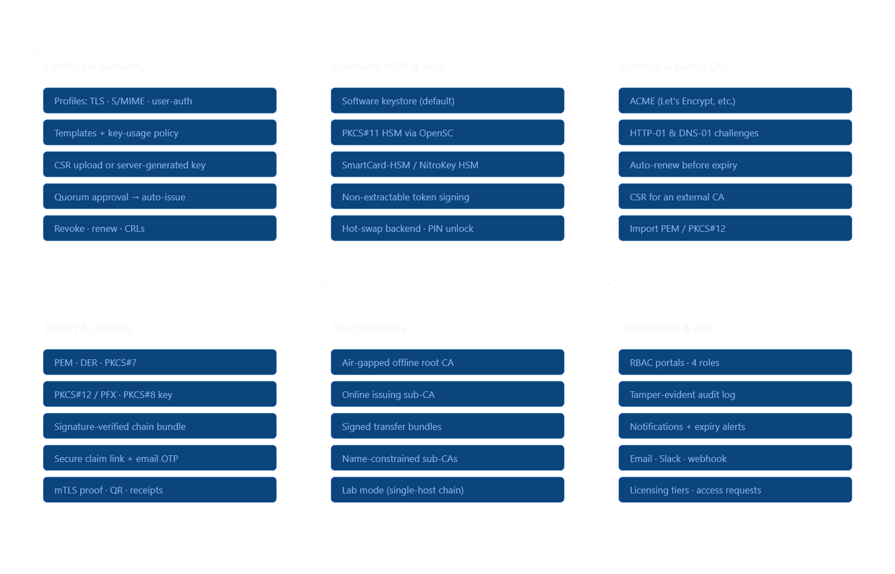
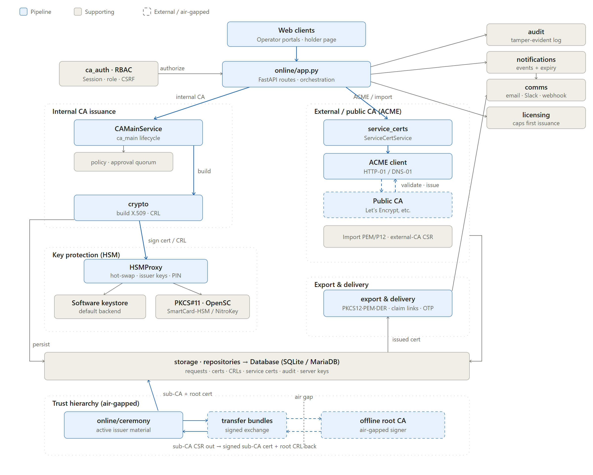

# myOwnCA

The current installation release is **v0.17.2**, with signed deployment bundles
for Linux [amd64](releases/0.17.2/amd64/INSTALL.md) and
[ARM64](releases/0.17.2/arm64/INSTALL.md). Matching prebuilt images are available
at `docker.io/enigmais/myownca:0.17.2`. Use the authenticated digest pinned in the
selected bundle's Compose file for deployment.

Read the [release notes](releases/0.17.2/RELEASE-NOTES.md), including the authorized
ARM64 emulation and deferred native testing, before installation or upgrade.

## Authenticate the release

Obtain the developer's SSH signing public key independently of this repository.
Provision an administrator-owned Git allowed-signers file containing that trusted
key, with the principal `myownca-release` and the `git` namespace. Then clone and
verify the selected release before running any downloaded code:

```sh
git clone --branch v0.17.2 https://github.com/EnigmaIS/myOwnCA.git myownca-install
cd myownca-install
git -c gpg.format=ssh \
  -c gpg.ssh.allowedSignersFile=/trusted/myownca-allowed-signers \
  verify-commit HEAD
git status --porcelain --untracked-files=all
```

Signature verification must succeed and the status output must be empty. An
allowed-signers entry has the form `myownca-release namespaces="git" ssh-ed25519
PUBLIC_KEY_DATA`; replace `PUBLIC_KEY_DATA` with the independently authenticated
key data. A key downloaded beside the release does not establish trust.

Also obtain the complete `BOOTSTRAP-SHA256SUMS` file and release-key fingerprint
through an independent authenticated channel. Check the hashes from
`releases/0.17.2/` and follow the selected architecture's INSTALL.md to provision
the verifier, authenticate the bundle and prepare Docker deployment. Preserve
signed bundles and state backups for recovery.

Installation releases and source snapshots are published independently. The source
snapshot retained here is **v0.12.5**; the development instructions and source
documentation below describe that snapshot. The v0.17.2 installation instructions
linked above are the entry point for production deployment.

**A private, self-hosted Certificate Authority for small businesses and home labs —
browser-driven, offline-root-capable, and free for genuine noncommercial use.**

myOwnCA replaces manual PKI with a guided web app while keeping a production-grade
operating model: an air-gapped offline root, online issuing sub-CAs, four-role
separation, install-level Single administrator or Dual control governance,
configurable certificate-approval quorum, PKCS#11 / smart-card key protection,
AWS KMS and Azure Key Vault signing keys,
an outbound ACME client for external certs, **automatic email expiry
reminders and certificate renewal**, **many export formats** (PEM · DER ·
PKCS#7 · PKCS#12/PFX), a tamper-evident audit log, and CRL/OCSP revocation
status. A first-run web wizard does the configuration for you.



## Quick start

**Docker:**

```bash
./scripts/gen-lab-cert.sh          # lab TLS for the proxy (or supply your own)
docker compose up -d --build
docker compose logs ca             # read the one-time setup URL + token
# browse http://127.0.0.1:8765/setup and complete the wizard
```

**Source development (Python 3.12+):**

```bash
python -m venv .venv && . .venv/bin/activate
pip install -e .                   # development checkout; production uses signed releases
myownca                            # prints a setup URL + token on first run
```

Both development workflows finish in the same browser-based setup wizard.
Production uses the [signed release workflow](docs/release-publishing.md),
with a prebuilt Docker image and a signed verification/deployment bundle. Docker
supports production and Test/Lab installations; the **Test/Lab** install type—not
Docker—creates an automatic, evaluation-only Root + Sub CA hierarchy. The
supplied Compose configuration is a single-host default using SQLite and
software-held keys. It does not include local PKCS#11 passthrough, high
availability, or independent portal network isolation; adapt the surrounding
deployment for production. Host-attached PKCS#11 deployments need a separately
validated integration and are not supplied by this Docker release. The wizard
provisions and activates the first issuing Sub CA before it permits **Finish setup**;
Root/Sub CA trust material is
read-only after first launch.
**Full documentation, architecture, security model, configuration, and the
offline-root ceremony:**
[`docs/README.md`](docs/README.md).

Current scope is self-hosted and single-installation. OCSP is implemented; ACME
support is an outbound client for external CAs, not a private ACME server.
Managed SaaS is a separate future product direction.

## Architecture



## Project layout

- `src/myownca/` — the single application distribution: online service, offline
  CLI, CA core, auth, software/PKCS#11/AWS/Azure HSM backends, cloud signing,
  storage, ACME + DNS-01, MariaDB, notifications, audit, licensing, holder
  portal, setup, and lifecycle automation. All runtime modules are installed by
  `pip install .`; no feature extra is required.
- `core/myownca_core/` — shared storage, key-generation, and leaf-building
  primitives. They are bundled in the main `myownca` wheel; `core/pyproject.toml`
  can still build the standalone `myownca-core` wheel for DeviceCA. The two
  distributions target separate environments and should not be co-installed.
- `docs/` — [full operator guide](docs/README.md), the
  [Docker runbook](docs/docker.md), the
  [cloud-key runbook](docs/cloud-key-providers.md), the
  [offline Root ceremony guide](docs/offline-root.md), and
  [licensing operations](docs/licensing.md), plus backup, upgrade, monitoring,
  incident-response, configuration, reverse-proxy, and certificate-lifecycle
  runbooks.
- `diags/` — architecture & feature diagrams.
- `tests/` — the test suite (`python -m pytest -q`).

## License

Source-available under the [EnigmaIS Source-Available Licence 1.0](LICENSE),
copyright EnigmaIS sp. z o. o. Source inspection is permitted; source modifications
and derivative versions are prohibited. Genuine noncommercial use is free within
the 10-active-identity allowance. Every commercial use, including commercial
evaluation, requires paid terms even below that limit. Normal settings, supported
APIs, and deployment configuration remain permitted. Internal deployment and backup
copies are allowed; redistribution requires written permission. Share official
download links instead. Third-party components retain their own licences.
See [Licensing](docs/README.md#licensing) for offline customer licence operation.
