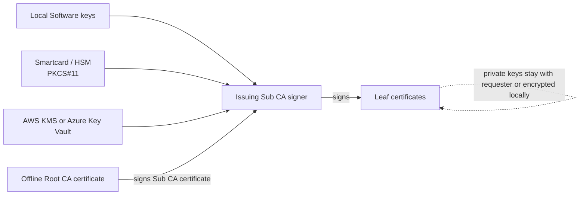
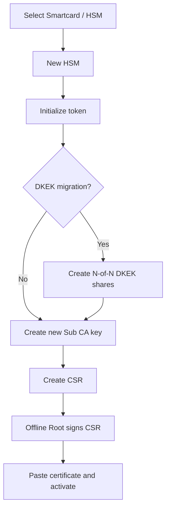
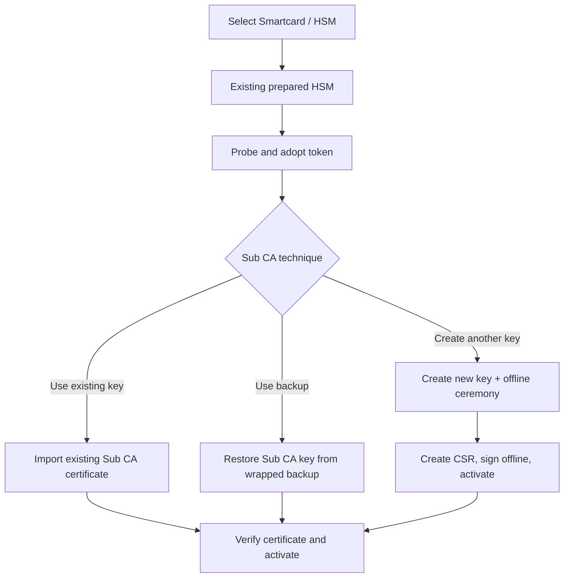
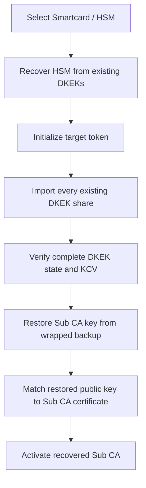
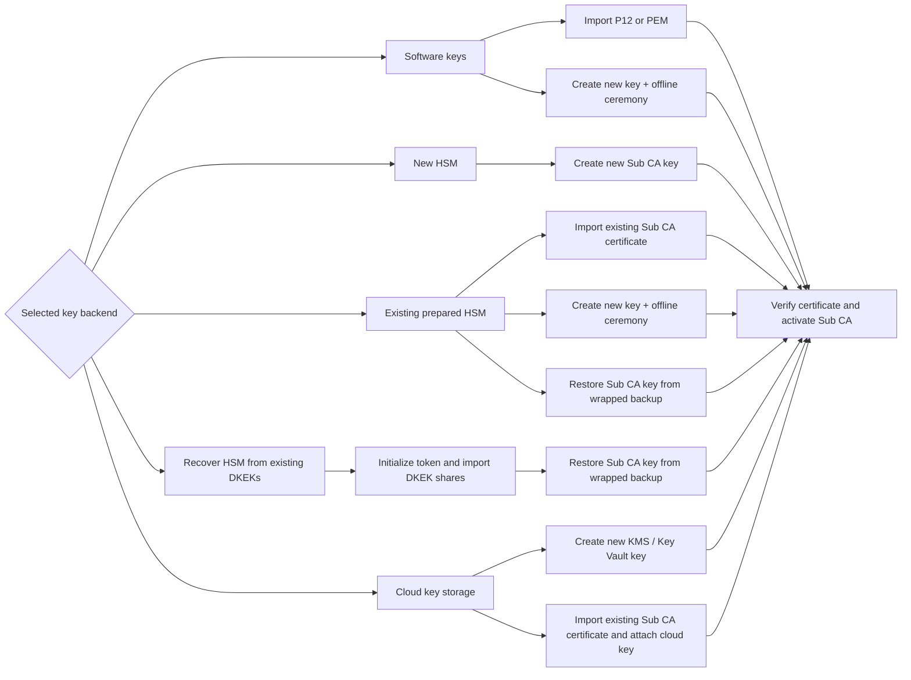

# Sub CA storage and provisioning maps

These diagrams summarize where the Issuing Sub CA signing key can live and
which provisioning technique applies to each setup choice.

## 1. Storage topology

The storage choice applies to the Sub CA signing key. Leaf private keys are not
stored in the HSM or cloud backend.

## 2. New HSM

## 3. Existing prepared HSM

## 4. Recover HSM from existing DKEKs

The recovery path restores the existing Sub CA identity; it does not create a
replacement Sub CA key.

## 5. Provisioning technique map

